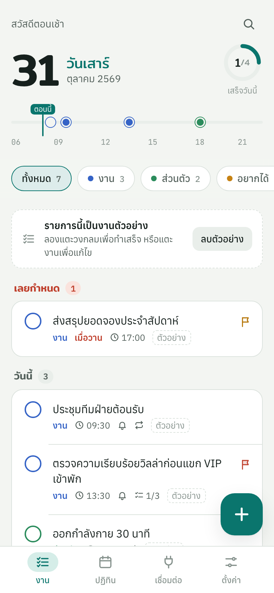
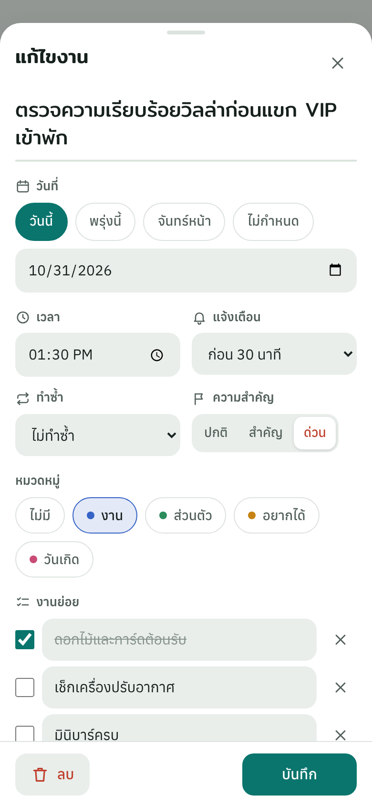
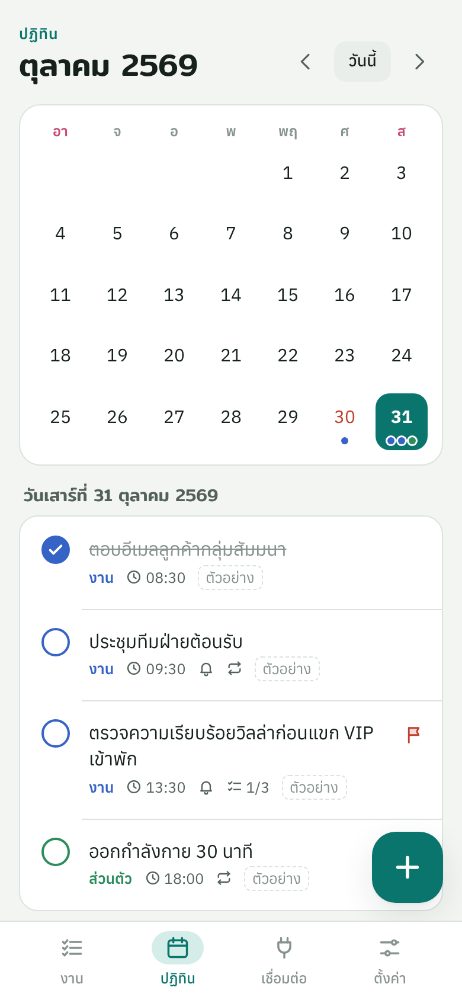
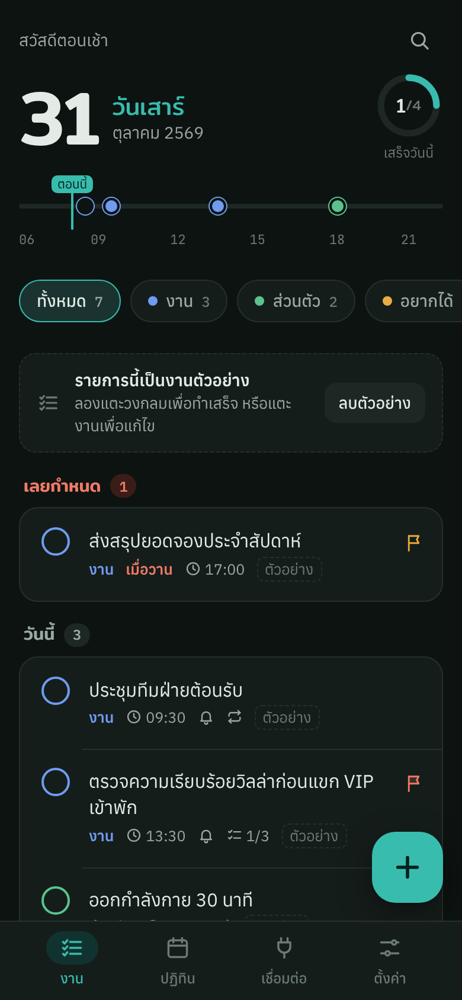
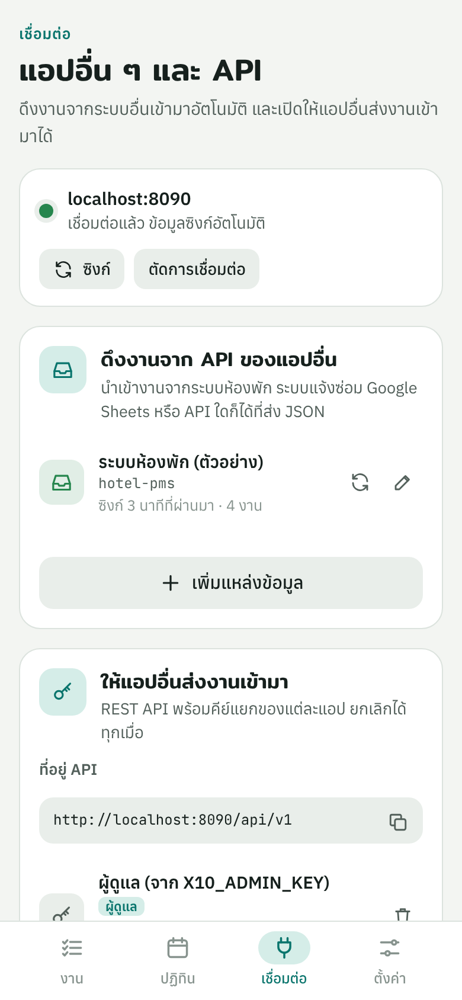
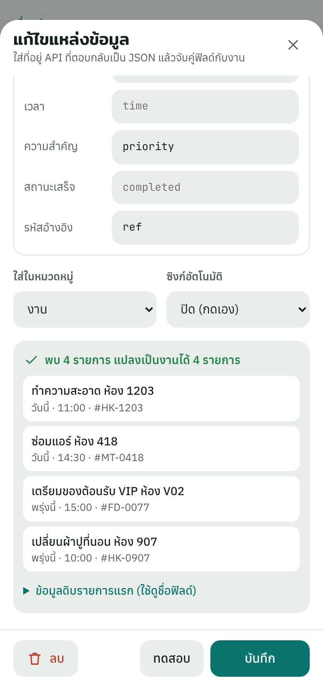

# X10 Tasks

แอปวางแผนงานประจำวันสำหรับมือถือ (ภาษาไทย) ติดตั้งลงหน้าจอโฮมได้เหมือนแอปทั่วไป ใช้งานออฟไลน์ได้
และ **เชื่อมต่อกับแอปอื่นผ่าน API** ได้ทั้งขาเข้าและขาออก

| งานวันนี้ | แก้ไขงาน | ปฏิทิน |
|---|---|---|
|  |  |  |
| **โหมดมืด** | **เชื่อมต่อแอปอื่น** | **ดึงงานจาก API** |
|  |  |  |

## ทำอะไรได้บ้าง

**จัดการงาน**
- งานแยกตามหมวดหมู่ (งาน, ส่วนตัว, อยากได้, วันเกิด และเพิ่มเองได้) พร้อมสีประจำหมวด
- จัดกลุ่มอัตโนมัติ: เลยกำหนด / วันนี้ / เร็ว ๆ นี้ / ไม่มีกำหนด / เสร็จแล้ว
- วันที่ เวลา แจ้งเตือนล่วงหน้า งานย่อย บันทึก และระดับความสำคัญ (ปกติ / สำคัญ / ด่วน)
- งานทำซ้ำ: ทุกวัน ทุกวันทำงาน ทุกสัปดาห์ ทุกเดือน ทุกปี (ทำเสร็จแล้วสร้างครั้งถัดไปให้เอง)
- **เส้นเวลาของวัน** แสดงงานที่มีเวลาบนแถบ 06:00–22:00 พร้อมตำแหน่ง “ตอนนี้” และวงแหวนความคืบหน้า
- ปฏิทินรายเดือน ค้นหา เลิกทำ (undo) ได้ทันทีหลังติ๊กเสร็จหรือลบ
- สถิติ 7 วัน ธีมสว่าง/มืด ส่งออก-นำเข้าไฟล์ JSON

**เชื่อมต่อแอปอื่น**
- **REST API ขาเข้า** ให้แอปอื่นส่งงานเข้ามา แต่ละแอปมีคีย์ของตัวเองและยกเลิกแยกได้ รับรูปแบบข้อมูลหลากหลาย
  (`title`/`text`/`name`, `due`/`dueDate`/`date`, วันที่แบบ `2026-11-05`, `05/11/2569`, `today`, `พรุ่งนี้` ฯลฯ)
- **ดึงงานจาก API ของแอปอื่น** (connector) ใส่ URL ที่ตอบเป็น JSON แล้วจับคู่ฟิลด์ เช่น `{{type}} ห้อง {{room}}`
  มีปุ่มทดสอบดูผลก่อนบันทึก ซิงก์อัตโนมัติตามรอบ และไม่สร้างงานซ้ำ (อ้างอิงด้วยรหัสของระบบต้นทาง)
- **Webhook ขาออก** ส่ง JSON ไปยังแอปอื่นเมื่อมีงานใหม่ แก้ไข เสร็จ หรือลบ พร้อมลายเซ็น HMAC-SHA256
- **อัปเดตสด** หลายเครื่องเห็นงานใหม่ทันที (Server-Sent Events)
- **ลิงก์เพิ่มงานด่วน** `/?add=ซื้อกาแฟ&due=today&time=15:00` และเมนู “แชร์” บน Android

## เริ่มใช้งาน

ต้องมี [Node.js](https://nodejs.org) 18 ขึ้นไป ไม่ต้องติดตั้งแพ็กเกจเพิ่ม

```bash
npm start
```

หน้าจอจะแสดงที่อยู่สำหรับเปิดบนคอมพิวเตอร์และมือถือ (Wi-Fi เดียวกัน) และ **คีย์ผู้ดูแล** ซึ่งแสดงครั้งเดียว ให้เก็บไว้
เปิดแอปแล้วกด “เชื่อมต่อ” ที่แถบด้านบน ใส่คีย์ผู้ดูแล เท่านี้ก็ซิงก์กับเซิร์ฟเวอร์และใช้ API ได้

| ตัวแปร | ค่าเริ่มต้น | ความหมาย |
|---|---|---|
| `PORT` | `8080` | พอร์ตของเซิร์ฟเวอร์ |
| `DATA_DIR` | `./data` | โฟลเดอร์เก็บข้อมูล (`db.json`) |
| `X10_TIMEZONE` | `Asia/Bangkok` | เขตเวลาที่ใช้ตีความ “วันนี้/พรุ่งนี้” จากแอปอื่น |
| `X10_ADMIN_KEY` | สุ่มให้ | กำหนดคีย์ผู้ดูแลเอง |

ลืมคีย์ผู้ดูแล: `node server/index.js --new-admin-key`

แอปใช้งานได้โดยไม่มีเซิร์ฟเวอร์ด้วย (ข้อมูลอยู่ในเครื่อง) แต่ฟีเจอร์ API ขาเข้า, webhook, และการซิงก์หลายเครื่องต้องใช้เซิร์ฟเวอร์

## ติดตั้งลงมือถือ

การติดตั้งเป็นแอปและการทำงานออฟไลน์ต้องเปิดผ่าน **HTTPS** (หรือ `localhost`) จึงควรนำเซิร์ฟเวอร์ขึ้นคลาวด์ เช่น

```bash
docker build -t x10-tasks .
docker run -p 8080:8080 -v x10data:/data -e X10_ADMIN_KEY=ตั้งคีย์ยาวๆเอง x10-tasks
```

แล้วตั้งค่าให้มี HTTPS (เช่น Render, Railway, Fly.io หรือ Cloudflare Tunnel)

- **Android (Chrome):** เปิดเว็บ → เมนู ⋮ → “ติดตั้งแอป” หรือกดปุ่ม “ติดตั้งแอป” ในหน้าตั้งค่า
- **iPhone (Safari):** เปิดเว็บ → ปุ่มแชร์ → “เพิ่มไปยังหน้าจอโฮม”

## เชื่อมต่อกับแอปอื่น

### 1. ให้แอปอื่นส่งงานเข้ามา

ในแอป ไปที่ **เชื่อมต่อ → สร้างคีย์ให้แอปใหม่** แล้วให้แอปนั้นเรียก:

```bash
curl -X POST https://your-server/api/v1/tasks \
  -H "Authorization: Bearer x10_คีย์ของแอป" \
  -H "Content-Type: application/json" \
  -d '{"title":"ตรวจห้อง 1203","due":"today","time":"14:00","category":"งาน","priority":"urgent"}'
```

ถ้าส่ง `externalId` มาด้วย การส่งซ้ำจะ **อัปเดตงานเดิม** แทนการสร้างใหม่ เหมาะกับการซิงก์จากระบบอื่น

### 2. ดึงงานจาก API ของแอปอื่น

**เชื่อมต่อ → เพิ่มแหล่งข้อมูล** ใส่ URL, header (เช่น `Authorization: Bearer …`), ตำแหน่งรายการใน JSON และจับคู่ฟิลด์
ลองเลือกแม่แบบ “ระบบห้องพัก (PMS)” เพื่อดูตัวอย่างการทำงานโดยไม่ต้องมีระบบจริง

### 3. ส่งข่าวไปแอปอื่น (Webhook)

**เชื่อมต่อ → เพิ่มปลายทาง** ระบบจะ `POST` ข้อมูลงานไปที่ URL นั้นทุกครั้งที่งานเปลี่ยน ใช้ร่วมกับ n8n, Make, Zapier
เพื่อแจ้งเข้ากลุ่ม LINE, Slack หรือบันทึกลง Google Sheets ได้

รายละเอียด API ทั้งหมด ตัวอย่าง Google Apps Script, iOS Shortcuts และการตรวจลายเซ็น webhook อยู่ใน [docs/API.md](docs/API.md)

## โครงสร้างโปรเจกต์

```
public/            แอปบนมือถือ (PWA) ไม่ต้อง build
  index.html
  css/app.css      ธีมและหน้าตาทั้งหมด (สว่าง/มืด)
  js/app.js        หน้าจอ การซิงก์ แจ้งเตือน
  js/shared.js     ตรรกะที่ใช้ร่วมกับเซิร์ฟเวอร์: ตีความข้อมูลจากแอปอื่น งานทำซ้ำ การจับคู่ฟิลด์
  sw.js            ทำงานออฟไลน์ + กดแจ้งเตือนแล้วเปิดงาน
  manifest.webmanifest
server/            Node.js ไม่มี dependency
  app.js           REST API, live stream, เสิร์ฟแอป
  store.js         เก็บข้อมูลเป็นไฟล์ JSON
  webhooks.js      ส่ง webhook พร้อมลายเซ็นและลองใหม่
  connectors.js    ดึงงานจาก API อื่นตามรอบ
test/              ทดสอบด้วย node:test
scripts/           สร้างไอคอน และไฟล์ตัวอย่างหน้าเดียว
```

## ทดสอบ

```bash
npm test
```

## ข้อจำกัดตอนนี้และขั้นต่อไป

- **แจ้งเตือนตอนปิดแอป:** ตอนนี้แจ้งเตือนเมื่อแอปเปิดอยู่ (รวมถึงอยู่เบื้องหลัง) ถ้าต้องการให้เด้งแม้ปิดแอป ต้องเพิ่ม Web Push จากเซิร์ฟเวอร์
- **วิดเจ็ตหน้าจอโฮมและขึ้น Play Store / App Store:** ห่อแอปนี้ด้วย [Capacitor](https://capacitorjs.com) โดยใช้โค้ดใน `public/` เดิม
- **หลายผู้ใช้:** ตอนนี้ออกแบบสำหรับ 1 คนหรือทีมเล็กที่ใช้รายการงานร่วมกัน ถ้าต้องการแยกบัญชีพนักงานแต่ละคน ควรเปลี่ยนที่เก็บข้อมูลเป็นฐานข้อมูล (เช่น SQLite/PostgreSQL) และเพิ่มระบบล็อกอิน
