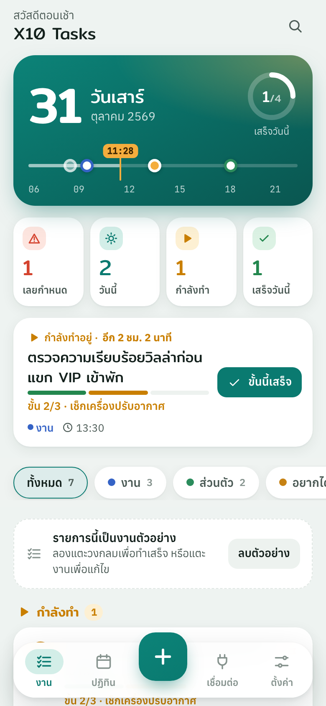
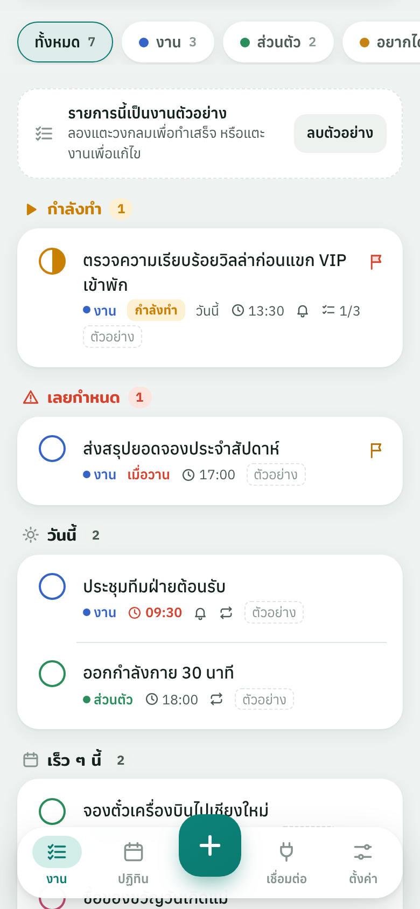
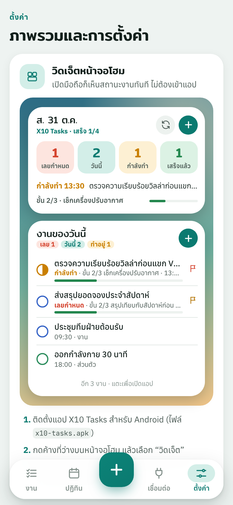
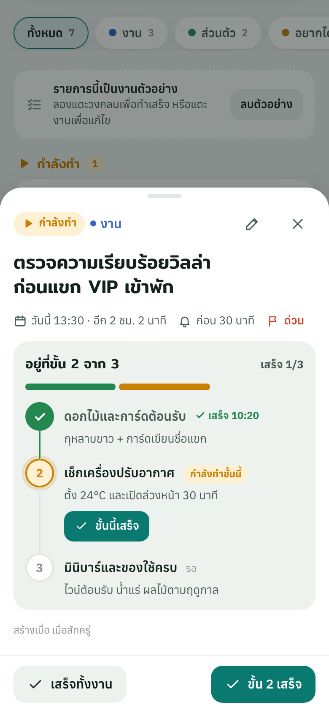
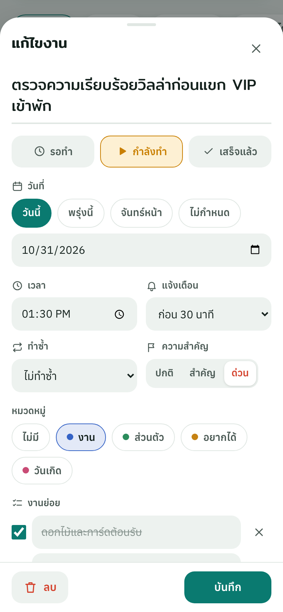
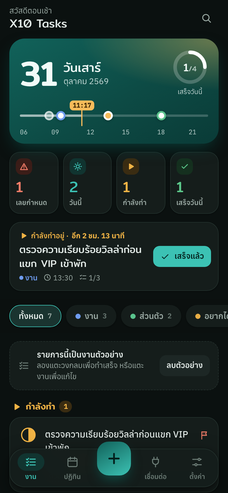
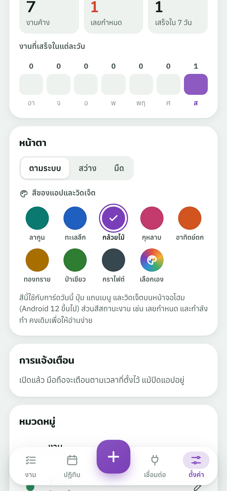
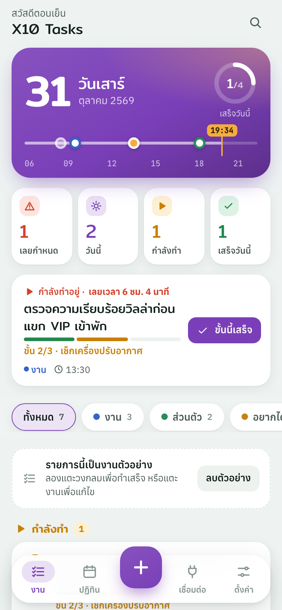
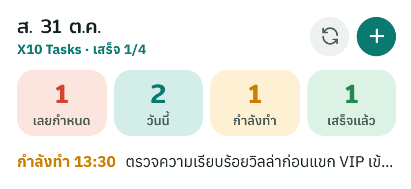
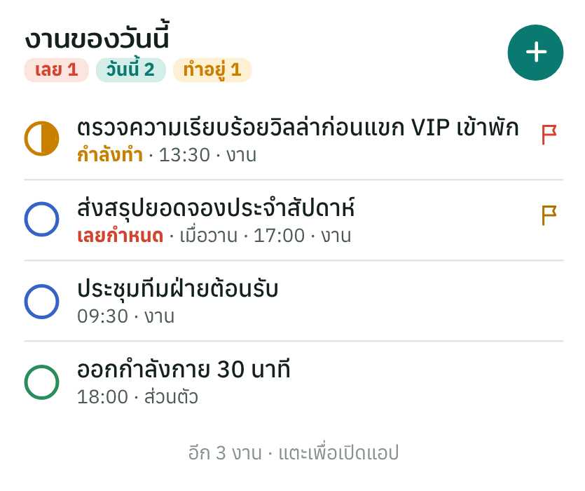

# X10 Tasks

แอปวางแผนงานประจำวันสำหรับมือถือ (ภาษาไทย) มี **วิดเจ็ตหน้าจอโฮมบน Android** ที่เปิดมือถือก็เห็นสถานะงานทันที
ใช้งานออฟไลน์ได้ และ **เชื่อมต่อกับแอปอื่นผ่าน API** ได้ทั้งขาเข้าและขาออก

| หน้าแรก | รายการงาน | วิดเจ็ตหน้าจอโฮม |
|---|---|---|
|  |  |  |
| **ขั้นตอนของงาน** | **แก้ไขขั้นตอน** | **โหมดมืด** |
|  |  |  |

## ปรับสีได้

| เลือกสีในตั้งค่า | ตัวอย่างสีกล้วยไม้ |
|---|---|
|  |  |

- **สีของแอปและวิดเจ็ต** (ตั้งค่า → หน้าตา): มี 8 สีให้เลือก ได้แก่ ลากูน, ทะเลลึก, กล้วยไม้, กุหลาบ, อาทิตย์ตก, ทองทราย, ป่าเขียว, กราไฟต์
  หรือกด **เลือกเอง** เพื่อใช้สีไหนก็ได้ เช่น สีประจำแบรนด์ของรีสอร์ต
- สีนี้ใช้กับการ์ดวันนี้ ปุ่ม แถบเมนู ปุ่ม + และ **วิดเจ็ตบนหน้าจอโฮม** (Android 12 ขึ้นไป) ในโหมดมืดแอปจะปรับเฉดสีให้เข้ากันเอง
  ถ้าเลือกสีที่อ่อนหรือเข้มเกินไป แอปจะปรับความเข้มให้ตัวอักษรยังอ่านออก
- สีบอกสถานะงาน (แดง = เลยกำหนด, ส้ม = กำลังทำ, เขียว = เสร็จ) คงเดิม เพื่อให้ดูสถานะได้ทันที
- **สีหมวดหมู่** เลือกจาก 6 สีหรือ **เลือกสีเอง** ได้เช่นกัน (ตั้งค่า → หมวดหมู่ → ไอคอนแก้ไข)

## ขั้นตอนของงาน: งานถึงไหนแล้ว

แบ่งงานเป็นขั้นตอนเรียงตามลำดับ แล้วดูได้ทันทีว่างาน **อยู่ที่ขั้นไหน**

- ทุกที่ที่แสดงงาน (รายการ การ์ด “ถัดไป” และวิดเจ็ต) จะบอก **“ขั้น 2/4 · ตรวจสอบหน้างาน”** พร้อมแถบความคืบหน้าแยกเป็นช่องตามขั้นตอน
  สีเขียวคือเสร็จแล้ว สีส้มคือกำลังทำ สีเทาคือยังรออยู่
- แตะงานเพื่อเปิด **หน้ารายละเอียด** ที่แสดงทุกขั้นเป็นเส้นลำดับ แต่ละขั้นมีชื่อ รายละเอียด และเวลาที่ทำเสร็จ (เช่น “เสร็จ 10:20”)
  ขั้นปัจจุบันมีป้าย “กำลังทำขั้นนี้” และปุ่ม **ขั้นนี้เสร็จ**
- ติ๊กขั้นแรกแล้วงานจะเปลี่ยนเป็น “กำลังทำ” ให้เอง ทำขั้นสุดท้ายเสร็จแล้วงานจะเสร็จทั้งงาน (กดเลิกทำได้)
- มี **ขั้นตอนสำเร็จรูป** ให้เลือก: ทำความสะอาดห้อง, แจ้งซ่อม, ต้อนรับแขก VIP, งานทั่วไป หรือเพิ่มขั้นเองพร้อมรายละเอียดและเลื่อนลำดับได้
- ระบบอื่นส่งขั้นตอนมาพร้อมงานได้ทาง API และปิดทีละขั้นได้ด้วย `POST /api/v1/tasks/:id/steps/:stepId/complete`

## วิดเจ็ตหน้าจอโฮม (Android)

| สรุปงานวันนี้ (4×2) | รายการงาน (ปรับขนาดได้) |
|---|---|
|  |  |

- **สรุปงานวันนี้**: จำนวนงาน เลยกำหนด / วันนี้ / กำลังทำ / เสร็จแล้ว งานถัดไป และขั้นที่งานนั้นอยู่ แตะช่องสถานะเพื่อเปิดแอปที่รายการนั้น
- **รายการงาน**: งานที่ต้องทำก่อน เรียงตาม กำลังทำ → เลยกำหนด → วันนี้ → เร็ว ๆ นี้ พร้อมขั้นที่กำลังทำและแถบความคืบหน้า
  แตะวงกลมเพื่อ **ปิดขั้นปัจจุบันจากหน้าจอโฮม** (งานที่ไม่มีขั้นตอนจะติ๊กเสร็จทั้งงาน)
  ยิ่งขยายวิดเจ็ตสูง ยิ่งเห็นงานมากขึ้น (สูงสุด 8 งาน)
- อัปเดตทันทีเมื่องานในแอปเปลี่ยน ถ้าเชื่อมต่อเซิร์ฟเวอร์ วิดเจ็ตจะดึงงานใหม่จากแอปอื่นเองทุก 30 นาทีหรือเมื่อกด ⟳ แม้ไม่ได้เปิดแอป
- มีปุ่ม + เพิ่มงานจากหน้าจอโฮม และรองรับโหมดมืดของระบบ
- แอป Android ยังแจ้งเตือนงานเป็น **การแจ้งเตือนของมือถือ แม้ปิดแอปอยู่**

### ติดตั้งแอป Android

1. ดาวน์โหลดไฟล์ `x10-tasks.apk` ลงมือถือ แล้วแตะเพื่อติดตั้ง (ครั้งแรกมือถือจะถามให้อนุญาต “ติดตั้งแอปที่ไม่รู้จัก” จากแอปที่ใช้เปิดไฟล์)
2. เปิดแอป X10 Tasks หนึ่งครั้ง
3. กดค้างที่ว่างบนหน้าจอโฮม → **วิดเจ็ต** → **X10 Tasks** → ลาก “สรุปงานวันนี้” หรือ “รายการงาน” ไปวาง
   (หรือในแอปไปที่ ตั้งค่า → วิดเจ็ตหน้าจอโฮม → “วางวิดเจ็ต”)

ต้องการ Android 7.0 ขึ้นไป แอปเป็นไฟล์ติดตั้งเอง (ยังไม่ได้ขึ้น Play Store)

สร้างไฟล์ APK เองบน Ubuntu/Debian ได้โดยไม่ต้องใช้ Android Studio:

```bash
sudo apt-get install aapt android-sdk-platform-23 dalvik-exchange zipalign apksigner openjdk-17-jdk
npm run android        # ได้ไฟล์ android/build/x10-tasks.apk
```

คีย์ที่ใช้เซ็นแอปเก็บไว้ที่ `~/.android/x10-tasks.keystore` ให้เก็บไฟล์นี้ไว้ การอัปเดตแอปครั้งต่อไปต้องเซ็นด้วยคีย์เดิม

## ทำอะไรได้บ้าง

**จัดการงาน**
- **สถานะงาน 3 แบบ**: รอทำ / กำลังทำ / เสร็จแล้ว (ระบบอื่นส่ง `in_progress`, `done` ฯลฯ มาได้)
- หน้าแรกแบบวิดเจ็ต: การ์ดวันนี้พร้อมวงแหวนความคืบหน้า ช่องสถานะ 4 ช่อง (แตะเพื่อกรอง) และการ์ด “ถัดไป” พร้อมปุ่ม เริ่มทำ / เสร็จแล้ว
- งานแยกตามหมวดหมู่ (งาน, ส่วนตัว, อยากได้, วันเกิด และเพิ่มเองได้) พร้อมสีประจำหมวด
- จัดกลุ่มอัตโนมัติ: กำลังทำ / เลยกำหนด / วันนี้ / เร็ว ๆ นี้ / ไม่มีกำหนด / เสร็จแล้ว
- วันที่ เวลา แจ้งเตือนล่วงหน้า งานย่อย บันทึก และระดับความสำคัญ (ปกติ / สำคัญ / ด่วน)
- งานทำซ้ำ: ทุกวัน ทุกวันทำงาน ทุกสัปดาห์ ทุกเดือน ทุกปี (ทำเสร็จแล้วสร้างครั้งถัดไปให้เอง)
- **เส้นเวลาของวัน** แสดงงานที่มีเวลาบนแถบ 06:00–22:00 พร้อมเวลาปัจจุบัน
- ปฏิทินรายเดือน ค้นหา เลิกทำ (undo) ได้ทันทีหลังติ๊กเสร็จหรือลบ
- สถิติ 7 วัน ธีมสว่าง/มืด ส่งออก-นำเข้าไฟล์ JSON

**เชื่อมต่อแอปอื่น**
- **REST API ขาเข้า** ให้แอปอื่นส่งงานเข้ามา แต่ละแอปมีคีย์ของตัวเองและยกเลิกแยกได้ รับรูปแบบข้อมูลหลากหลาย
  (`title`/`text`/`name`, `due`/`dueDate`/`date`, วันที่แบบ `2026-11-05`, `05/11/2569`, `today`, `พรุ่งนี้` ฯลฯ)
- **ดึงงานจาก API ของแอปอื่น** (connector) ใส่ URL ที่ตอบเป็น JSON แล้วจับคู่ฟิลด์ เช่น `{{type}} ห้อง {{room}}`
  มีปุ่มทดสอบดูผลก่อนบันทึก ซิงก์อัตโนมัติตามรอบ และไม่สร้างงานซ้ำ (อ้างอิงด้วยรหัสของระบบต้นทาง)
- **Webhook ขาออก** ส่ง JSON ไปยังแอปอื่นเมื่อมีงานใหม่ แก้ไข เสร็จ หรือลบ พร้อมลายเซ็น HMAC-SHA256
- **อัปเดตสด** หลายเครื่องเห็นงานใหม่ทันที (Server-Sent Events)
- **ลิงก์เพิ่มงานด่วน** `/?add=ซื้อกาแฟ&due=today&time=15:00` และเมนู “แชร์” บน Android

## เริ่มใช้งาน

ต้องมี [Node.js](https://nodejs.org) 18 ขึ้นไป ไม่ต้องติดตั้งแพ็กเกจเพิ่ม

```bash
npm start
```

หน้าจอจะแสดงที่อยู่สำหรับเปิดบนคอมพิวเตอร์และมือถือ (Wi-Fi เดียวกัน) และ **คีย์ผู้ดูแล** ซึ่งแสดงครั้งเดียว ให้เก็บไว้
เปิดแอปแล้วกด “เชื่อมต่อ” ที่แถบด้านบน ใส่คีย์ผู้ดูแล เท่านี้ก็ซิงก์กับเซิร์ฟเวอร์และใช้ API ได้

| ตัวแปร | ค่าเริ่มต้น | ความหมาย |
|---|---|---|
| `PORT` | `8080` | พอร์ตของเซิร์ฟเวอร์ |
| `DATA_DIR` | `./data` | โฟลเดอร์เก็บข้อมูล (`db.json`) |
| `X10_TIMEZONE` | `Asia/Bangkok` | เขตเวลาที่ใช้ตีความ “วันนี้/พรุ่งนี้” จากแอปอื่น |
| `X10_ADMIN_KEY` | สุ่มให้ | กำหนดคีย์ผู้ดูแลเอง |

ลืมคีย์ผู้ดูแล: `node server/index.js --new-admin-key`

แอปใช้งานได้โดยไม่มีเซิร์ฟเวอร์ด้วย (ข้อมูลอยู่ในเครื่อง) แต่ฟีเจอร์ API ขาเข้า, webhook, และการซิงก์หลายเครื่องต้องใช้เซิร์ฟเวอร์

## ติดตั้งลงมือถือ

การติดตั้งเป็นแอปและการทำงานออฟไลน์ต้องเปิดผ่าน **HTTPS** (หรือ `localhost`) จึงควรนำเซิร์ฟเวอร์ขึ้นคลาวด์ เช่น

```bash
docker build -t x10-tasks .
docker run -p 8080:8080 -v x10data:/data -e X10_ADMIN_KEY=ตั้งคีย์ยาวๆเอง x10-tasks
```

แล้วตั้งค่าให้มี HTTPS (เช่น Render, Railway, Fly.io หรือ Cloudflare Tunnel)

- **Android (Chrome):** เปิดเว็บ → เมนู ⋮ → “ติดตั้งแอป” หรือกดปุ่ม “ติดตั้งแอป” ในหน้าตั้งค่า
- **iPhone (Safari):** เปิดเว็บ → ปุ่มแชร์ → “เพิ่มไปยังหน้าจอโฮม”

## เชื่อมต่อกับแอปอื่น

### 1. ให้แอปอื่นส่งงานเข้ามา

ในแอป ไปที่ **เชื่อมต่อ → สร้างคีย์ให้แอปใหม่** แล้วให้แอปนั้นเรียก:

```bash
curl -X POST https://your-server/api/v1/tasks \
  -H "Authorization: Bearer x10_คีย์ของแอป" \
  -H "Content-Type: application/json" \
  -d '{"title":"ตรวจห้อง 1203","due":"today","time":"14:00","category":"งาน","priority":"urgent"}'
```

ถ้าส่ง `externalId` มาด้วย การส่งซ้ำจะ **อัปเดตงานเดิม** แทนการสร้างใหม่ เหมาะกับการซิงก์จากระบบอื่น

### 2. ดึงงานจาก API ของแอปอื่น

**เชื่อมต่อ → เพิ่มแหล่งข้อมูล** ใส่ URL, header (เช่น `Authorization: Bearer …`), ตำแหน่งรายการใน JSON และจับคู่ฟิลด์
ลองเลือกแม่แบบ “ระบบห้องพัก (PMS)” เพื่อดูตัวอย่างการทำงานโดยไม่ต้องมีระบบจริง

### 3. ส่งข่าวไปแอปอื่น (Webhook)

**เชื่อมต่อ → เพิ่มปลายทาง** ระบบจะ `POST` ข้อมูลงานไปที่ URL นั้นทุกครั้งที่งานเปลี่ยน ใช้ร่วมกับ n8n, Make, Zapier
เพื่อแจ้งเข้ากลุ่ม LINE, Slack หรือบันทึกลง Google Sheets ได้

รายละเอียด API ทั้งหมด ตัวอย่าง Google Apps Script, iOS Shortcuts และการตรวจลายเซ็น webhook อยู่ใน [docs/API.md](docs/API.md)

## โครงสร้างโปรเจกต์

```
android/           แอป Android: WebView ที่โหลดแอปจาก public/ + วิดเจ็ตหน้าจอโฮม + การแจ้งเตือน
  build.sh         สร้าง APK ด้วย aapt/javac/dx/apksigner (ไม่ต้องใช้ Gradle)
  src/…/Widgets.java        หน้าตาวิดเจ็ตและปุ่มต่าง ๆ
  src/…/WidgetData.java     ข้อมูลวิดเจ็ต (จัดกลุ่มสถานะด้วยวันที่ของมือถือ)
  src/…/Bridge.java         window.X10Native ที่แอปเว็บเรียกใช้
  res/layout/widget_*.xml   เลย์เอาต์วิดเจ็ต
public/            แอปบนมือถือ (PWA) ไม่ต้อง build
  index.html
  css/app.css      ธีมและหน้าตาทั้งหมด (สว่าง/มืด)
  js/app.js        หน้าจอ การซิงก์ แจ้งเตือน
  js/shared.js     ตรรกะที่ใช้ร่วมกับเซิร์ฟเวอร์: ตีความข้อมูลจากแอปอื่น งานทำซ้ำ การจับคู่ฟิลด์
  sw.js            ทำงานออฟไลน์ + กดแจ้งเตือนแล้วเปิดงาน
  manifest.webmanifest
server/            Node.js ไม่มี dependency
  app.js           REST API, live stream, เสิร์ฟแอป
  store.js         เก็บข้อมูลเป็นไฟล์ JSON
  webhooks.js      ส่ง webhook พร้อมลายเซ็นและลองใหม่
  connectors.js    ดึงงานจาก API อื่นตามรอบ
test/              ทดสอบด้วย node:test
scripts/           สร้างไอคอน ภาพตัวอย่างวิดเจ็ต และไฟล์ตัวอย่างหน้าเดียว
```

## ทดสอบ

```bash
npm test
```

## ข้อจำกัดตอนนี้และขั้นต่อไป

- **แจ้งเตือนตอนปิดแอป:** แอป Android แจ้งเตือนได้แม้ปิดแอป (อาจคลาดจากเวลาที่ตั้งได้ไม่กี่นาทีตอนมือถือประหยัดพลังงาน) ส่วนเวอร์ชันเว็บแจ้งเตือนได้เฉพาะตอนเปิดแอปไว้
- **iPhone:** วิดเจ็ตบน iPhone ต้องเขียนด้วย WidgetKit (Swift) และ build บน Mac แยกต่างหาก ตอนนี้ iPhone ใช้เวอร์ชันเว็บได้ แต่ยังไม่มีวิดเจ็ต
- **Play Store:** ไฟล์ APK นี้ติดตั้งเองได้ทันที ถ้าจะขึ้น Play Store ต้องสร้างบัญชีนักพัฒนาและเซ็นด้วยคีย์สำหรับเผยแพร่
- **หลายผู้ใช้:** ตอนนี้ออกแบบสำหรับ 1 คนหรือทีมเล็กที่ใช้รายการงานร่วมกัน ถ้าต้องการแยกบัญชีพนักงานแต่ละคน ควรเปลี่ยนที่เก็บข้อมูลเป็นฐานข้อมูล (เช่น SQLite/PostgreSQL) และเพิ่มระบบล็อกอิน
